# Olá, eu sou o Pedro Hugo 👋

Estudante de **Ciência da Computação** na **UNAMA**, apaixonado por tecnologia e desenvolvimento de software. Atualmente, estou estudando e criando projetos com tecnologias web e aplicações em C++.

## 📊 Estatísticas

  
  

## 🚀 Tecnologias

| C++ | JavaScript | CSS | HTML |
|:---:|:---:|:---:|:---:|
|  C++ |  JavaScript |  CSS |  HTML |

| PHP | MySQL |
|:---:|:---:|
|  PHP |  MySQL |

## 📚 Atualmente

- 🎓 Cursando Ciência da Computação na UNAMA
- 💻 Desenvolvendo projetos em C++ e tecnologias web
- 🌐 Aprimorando conhecimentos em PHP e integração com MySQL
- 🚀 Praticando JavaScript, HTML e CSS

## 📂 Principais Repositórios

## 📫 Contato

- GitHub: [@pedrugo05](https://github.com/pedrugo05)

<picture>
  <source media="(prefers-color-scheme: dark)" srcset="https://raw.githubusercontent.com/pedrugo05/pedrugo05/pacman-output/pacman-contribution-graph-dark.svg?game=pacman">
  <source media="(prefers-color-scheme: light)" srcset="https://raw.githubusercontent.com/pedrugo05/pedrugo05/pacman-output/pacman-contribution-graph.svg?game=pacman">
  
</picture>

